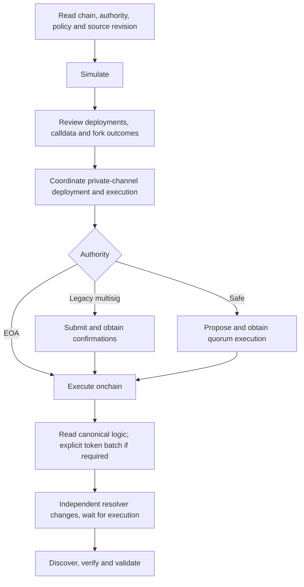

# Deployment tooling

Maintained operator guide for contracts **1.16.0**. Run commands from
`packages/ethereum-contracts`, after installing workspace dependencies and building
the selected source revision. Production transaction construction lives in
[Foundry scripts](../foundry-scripts), orchestration in [bash wrappers](../new-ops-scripts),
and Safe transaction-service integration in [safe-ops.ts](../new-ops-scripts/safe-ops.ts).
Local fixtures remain separate: `yarn testenv:deploy` and the
[test fixture](../test/lib/deploy-framework.ts).

The [deployment inventory](deployment-inventory.md) records observations and
blocks from 2026-11-10, not live configuration. The
[frozen migration disposition](plans/2026-11-truffle-migration-disposition.md)
accounts for old commands/options; it is not an alternative operator interface.

## One side-effect policy

**Every transaction/proposal wrapper simulates by default. Only `--broadcast`
enables onchain transactions AND Safe proposal submission.** Unknown arguments
fail. Native recovery requires **both** `--broadcast --resume`; `--resume` alone
fails. No environment variable switches simulation/broadcast mode.

[ops.sh](../new-ops-scripts/lib/ops.sh) is the shared argument, environment,
sender/authentication and payload policy. Exported caller values win over package
and parent `.env` defaults. Prerequisites are Bash, jq, Node/Yarn and Foundry
(`forge`, `cast`; `anvil` for local tests). Simulations do not unlock a wallet.

- RPC resolution and chain binding are centralized in
  [network-config.sh](../new-ops-scripts/lib/network-config.sh): `RPC_URL`, then
  `PROVIDER_URL_OVERRIDE`, then `PROVIDER_URL_TEMPLATE` containing `{{NETWORK}}`,
  then metadata's first public RPC. **Every wrapper checks the RPC chain ID against
  its named metadata network. There is no local-chain mismatch bypass.** Leaf JS/TS
  CLIs receive `--rpc-url`; use bash entry points for environment/metadata lookup.
- Broadcast authentication uses `PRIVATE_KEY` or encrypted Foundry account
  `WALLET_NAME` (default `sf-ops`). Import with `cast wallet import sf-ops --interactive`.
  [Keystore helpers](../new-ops-scripts/lib/keystore-env.sh) support interactive
  passwords, `KEYSTORE_PASSWORD_FILE`, `KEYSTORE_PASSWORD` (including empty), or
  `SF_KEYSTORE_PASSWORD_FILE`. Protect password files; do not export `ETH_PASSWORD`
  globally. The deterministic deployer separately needs its contract-specific
  vanity key; its funding account follows the same authentication policy.
- Governance and resolver authority are independent. [DeployUtils](../foundry-scripts/utils/DeployUtils.sol)
  autodetects EOA, legacy multisig and Safe. Simulation derives an EOA admin or a
  legacy multisig owner without keys. When a resolver has multiple admins, supply
  authorized `RESOLVER_ADMIN`; it must hold `DEFAULT_ADMIN_ROLE`.
  SimpleACL is not enumerable: ACL simulation requires explicit `DEPLOYER` or
  `SIMULATION_SENDER` with authority. Never substitute governance ownership for
  resolver or ACL authority.
  For fresh/permissionless deployment predictions, set `DEPLOYER` (or
  `SIMULATION_SENDER`) to the intended public sender. Keyless defaults need not
  predict the addresses a different broadcast account would create.
- Safe submission requires `SAFE_PROPOSER_PK` and any service credentials
  (`SAFE_API_KEY`, optional `SAFE_TX_SERVICE_URL`); `SAFE_ORIGIN` labels proposals.
  A proposer is not an execution quorum. A legacy multisig submission may execute
  immediately when its threshold is met. A Safe proposal never proves execution.
- New payload collections use `.tmp/<chainId>-<action>[-dry-run].jsonl`, with
  framework actions named `framework-<action>`. Simulation and broadcast defaults
  cannot overwrite one another. `SAFE_PAYLOADS_FILE` overrides the path; archive
  reviewed payloads before another same-chain/action invocation. Resume preserves
  its collection. Payloads bind `chainId` and `simulated`; the Safe CLI rejects
  simulated/unbound payloads on submission and wrong-chain payloads in either mode.

## Supported operations and limits

All 16 networks in [metadata](../../metadata/networks.json) are supported. Read
current policy, authority and deployed code before acting; metadata alone is not
proof. The [inventory](deployment-inventory.md) establishes the supported shape:
upgradeable hosts, EOA testnet governance, Safe 1.3.0 mainnet governance, and EOA
or legacy-multisig resolver administration.

| Capability | Interface / source |
| --- | --- |
| Fresh upgradeable framework and periphery | `framework.sh NETWORK fresh`; [FrameworkScript](../foundry-scripts/Framework.s.sol) |
| Framework, GovernanceII or explicit token logic upgrade | `upgrade`, `upgrade-governance`, `upgrade-tokens '[0xA,0xB]'` in the same wrapper |
| Separate authority handovers | `handover-governance OWNER`, `handover-acl ADMIN`, `grant-resolver-admin ADMIN`, `revoke-resolver-admin OLD NEW` |
| Explicit testnet faucet/wrapper | `provision-test-token NAME SYMBOL DECIMALS MINT_LIMIT`; [script](../foundry-scripts/ProvisionTestToken.s.sol) |
| Governance set/clear/forwarder/admin actions | [gov-action.sh](../new-ops-scripts/gov-action.sh), typed [GovAction](../foundry-scripts/GovAction.s.sol) entry points |
| Resolver key, listing, unlisting, registration, reset | [resolver-set-key.sh](../new-ops-scripts/resolver-set-key.sh), [resolver-token.sh](../new-ops-scripts/resolver-token.sh) |
| Native/pure SuperToken deployment | [deploy-custom-super-token.sh](../new-ops-scripts/deploy-custom-super-token.sh); ERC20 wrappers use permissionless factory calls |
| Yield backend deployment and token administration | [deploy-yield-backend.sh](../new-ops-scripts/deploy-yield-backend.sh), [super-token-admin-action.sh](../new-ops-scripts/super-token-admin-action.sh), single/batch withdrawal wrappers |
| ACL grants / transfer | `acl-grant-role.sh NETWORK ROLE_NAME GRANTEE`, `transfer-simple-acl-admin.sh NETWORK RECIPIENT` |
| Safe owner addition | [gov-safe-add-owner.sh](../new-ops-scripts/gov-safe-add-owner.sh); preserves each Safe's threshold |
| Forwarder rollout | `deploy-forwarder.sh CONTRACT NETWORK [PHASE]`; existing task/ClearMacro entry points select a row in [forwarders.json](../new-ops-scripts/lib/forwarders.json) |
| Address discovery, source verification, post-action validation | [discovery](../new-ops-scripts/lib/framework-discovery.js) shared by `info-print-contract-addresses.sh` and `verify-framework.sh` |

Fresh defaults have **one** source: [ChainPolicy.sol](../foundry-scripts/utils/ChainPolicy.sol).
Upgrades always read callback gas, app whitelisting, IDA freeze/slots and PPP from
the existing chain. **Changing an immutable through upgrade tooling is unsupported;
there are no override knobs.** Reward, ACL, resolver state and existing forwarder
addresses are retained, not re-derived from fresh defaults.

An ordinary `upgrade` always deploys current host, agreement, factory, token, NFT,
pool implementations and linked libraries, then routes one `updateContracts`.
It is not a bytecode comparator. Repeating it creates another implementation set;
recover an interrupted plan with native resume, not an ordinary rerun. Token
batches are separate and use the canonical logic **after** framework execution.
`ALL` token discovery is unsupported; supply reviewed bounded address arrays.
Tokens must belong to the host and have a supported proxy UUID and host/zero admin.
Direct TestGovernance has no GovernanceII implementation upgrade path.

## Execution order and recovery



Bootstrap retains the deployed proxy contract types: creation, `initializeProxy`
and initialization are separate transactions. Ownership/linkage checks and
castration do **not** make bootstrap atomic. Use a private transaction channel;
inspect initialization and ownership before handover. During upgrade,
`updateContracts` castrates host/agreement implementations during execution.
Pre-castrating them breaks execution; third-party initialization while they await
approval can grief it. Coordinate implementation deployment with governance
execution rather than leaving publicly deployed implementations awaiting an
unprepared approval process. Atomic pure/native-token initialization does not
change the framework's inherited initialization window.

Preserve both Foundry `broadcast/` **and** `cache/`, original source, signer,
chain and action arguments. Inspect receipts/nonces after an uncertain submission.
Fresh refuses an existing same-chain broadcast artifact unless resuming; archive
artifacts only for an intentional new deployment, never to bypass recovery.
Resume does not confirm governance execution. A completed fresh resume must not
deploy duplicates. There is no bespoke recovery state engine.

## Copyable recipes

Examples are recipes, not live transcripts. Do not broadcast during implementation
or CI validation. Set real addresses and credentials before operator use.

```bash
export NETWORK=eth-sepolia
export RPC_URL="https://${NETWORK}.rpc.x.superfluid.dev"
export RELEASE_VERSION=v1
bash new-ops-scripts/info-print-contract-addresses.sh "$NETWORK"
bash new-ops-scripts/framework.sh "$NETWORK" upgrade  # simulation
# Operator-only, after review/private-channel coordination:
bash new-ops-scripts/framework.sh "$NETWORK" upgrade --broadcast
# Same interrupted plan only:
bash new-ops-scripts/framework.sh "$NETWORK" upgrade --broadcast --resume
```

Discovery emits JSON with snapshot block/hash, addresses, source/constructor/library
targets, `errors` and `unsupported`. Check `errors: []`, not a simulated "executed"
message. Safe payloads are retained in the reported collection; submission reports
Safe hash/nonce, not execution. Inspect chain, Safe, target, value, operation and
calldata before quorum approval.

### Fresh on a new chain

1. Add a metadata entry with a canonical `name`, actual numeric `chainId`,
   `publicRPCs` and empty `contractsV1` (no host). Set `METADATA_JSON` to a reviewed
   custom file if the upstream metadata has not been published yet.
2. Add/review that chain's fresh policy in [ChainPolicy.sol](../foundry-scripts/utils/ChainPolicy.sol)
   and rebuild. Unknown networks and unsupported chain policies fail explicitly;
   an RPC override alone is not a metadata entry. Local tests use their own
   metadata with chain ID 31337, not a production bypass.
3. Simulate `deploy-erc1820.sh NETWORK`. If absent, an operator must broadcast the
   canonical presigned registry prerequisite before fresh deployment. It funds the
   canonical signer up to 0.1 native currency; it does not sign the registry raw tx.
4. Simulate `framework.sh NETWORK fresh`; then, after review, broadcast it. Fresh
   prints host/resolver/governance addresses. Record **broadcasted** addresses,
   update metadata, and export `HOST_ADDRESS` / `RESOLVER_ADDRESS` for handovers.
   Fresh creates a new resolver. Existing metadata hosts require explicit
   `ALLOW_EXISTING_FRAMEWORK=1` for intentional replacement, never silent reset.
5. Simulate/broadcast handovers independently. Grant resolver admin, wait for
   execution, then revoke the old admin. `handover-acl` removes deployer default
   authority; `transfer-simple-acl-admin.sh` also transfers a held app-registration
   admin role. Re-read roles/ownership before considering handover complete.

```bash
bash new-ops-scripts/framework.sh "$NETWORK" handover-governance "$NEW_GOV_OWNER"
DEPLOYER="$OLD_ACL_ADMIN" bash new-ops-scripts/transfer-simple-acl-admin.sh "$NETWORK" "$NEW_ACL_ADMIN"
bash new-ops-scripts/framework.sh "$NETWORK" grant-resolver-admin "$NEW_RESOLVER_ADMIN"
# Only after successful grant execution:
bash new-ops-scripts/framework.sh "$NETWORK" revoke-resolver-admin "$OLD_RESOLVER_ADMIN" "$NEW_RESOLVER_ADMIN"
```

### Tokens, roles, Safe review and forwarders

```bash
bash new-ops-scripts/deploy-custom-super-token.sh "$NETWORK" pure 'Migration Pure' MIGPURE 1000000000000000000
RELEASE_VERSION=v1 bash new-ops-scripts/resolver-token.sh "$NETWORK" list "$TOKEN"
RELEASE_VERSION=v1 bash new-ops-scripts/resolver-token.sh "$NETWORK" unlist MIGPURE
bash new-ops-scripts/gov-action.sh "$NETWORK" setTokenMinimumDeposit "$TOKEN" 424242
DEPLOYER="$ACL_ADMIN" bash new-ops-scripts/acl-grant-role.sh "$NETWORK" ACL_SUPERAPP_REGISTRATION_ROLE "$GRANTEE"
bash tasks/deploy-cfa-forwarder.sh "$NETWORK" all
# After activation actually executes, resume publication:
ALLOW_UPDATE=1 bash tasks/deploy-cfa-forwarder.sh "$NETWORK" register
npx ts-node new-ops-scripts/safe-ops.ts propose-file --rpc-url "$RPC_URL" --payload-file "$REVIEWED_PAYLOAD" --mode single
# Submission is explicit even when using this CLI directly:
npx ts-node new-ops-scripts/safe-ops.ts propose-file --rpc-url "$RPC_URL" --payload-file "$REVIEWED_PAYLOAD" --mode single --broadcast
```

Listing requires explicit release; symbol defaults to `symbol()` unless overridden.
Occupied resolver entries require deliberate `ALLOW_UPDATE=1`. Reset writes two
keys separately, not atomically. ERC20 wrapper creation is a permissionless factory
`createERC20Wrapper` call (`cast call` to preview, `cast send` for operator execution).
Yield wrappers and batch withdrawal use the same explicit broadcast policy.
The multi-token withdrawal wrapper does not support native `--resume`: each token
has its own Foundry plan. Resume an individual saved token operation instead;
there is no batch recovery state engine.

Every forwarder entry point takes the same positional phase:
`all|deploy|verify|activate|register`. A new forwarder needs its distinct vanity key
from the canonical table even for simulation; existing deployed code needs none.
Simulation stops before activation/registration when no bytecode exists. A Safe
activation proposal is not activation: registration checks actual host trust.
Rerun `register` after execution. ClearMacro provider grants apply only to the
configured ClearMacro entries and an explicit relay-executor grantee.

### Verification and validation

```bash
bash new-ops-scripts/verify-framework.sh "$NETWORK" --plan  # read-only JSON, no explorer requests
bash new-ops-scripts/verify-framework.sh "$NETWORK"         # source verification, no transactions
bash new-ops-scripts/info-print-contract-addresses.sh "$NETWORK" --validate
```

Use `--host`, `--resolver`, `--release` (or exported host/resolver) for a fresh or
alternate deployment. Explicit CLI addresses take precedence. Validation uses the
same address walker, checks UUIDs/linkage/NFT URI/agreement types/CFA trust, and
returns component errors with nonzero exit; it is not an economic/security audit.
It needs no Hardhat, typechain or keystore. Verification defaults to keyless
Sourcify; Etherscan accepts `ETHERSCAN_API_KEY`/`ETHERSCAN_API_V2_KEY`, Blockscout
requires an explicit verifier URL. See [verification options](../new-ops-scripts/verify-framework.js)
and [discovery](../new-ops-scripts/lib/framework-discovery.js), not duplicated
source error strings.

Historical code needs its matching source/compiler revision. Arbitrary underlying
ERC20s/external automation contracts are not verified. Unsupported historical
implementations remain explicit and cause actual verification to fail. An upgraded
beacon's constructor is its **original**, not current, implementation; archive
history or `--constructor-args-file` may be necessary. Explorer proxy/source
verification is included; explorer proxy/implementation association is unsupported.
`--skip-tokens` narrows verification deliberately, not a claim of complete coverage.

## Tests and CI

`yarn test` runs the ordinary suites, including Foundry ops tests and verification
argument regressions, without the new live-fork deployment suite. Contracts CI
runs `yarn deployment-local` once for actual local-Anvil transactions, simulation
boundaries, typed EOA operations and interrupted fresh recovery. Live deployment
fork tests are a separate opt-in `yarn deployment-forks` outside `test:*:*`; they
exercise real Safe 1.3.0 payload execution, EOA upgrades, legacy-multisig resolver
execution and deployed-policy preservation. They never submit live transactions
or proposals. Manual operation workflows remain simulation-only and reject
broadcast/resume flags in free-form operation arguments.

## Consumer migration

Contracts 1.16.0 removes published `build/truffle/*.json` and Truffle runtime/config
entry points without aliases. Use qualified Hardhat `.abi` imports or the existing
`build/bundled-abi.js` / `.json` exports. JSON path changes do not reproduce Truffle
`deployed()`/`at()`, BN/receipt/log abstractions, deployment addresses or linking.
Read metadata/resolver/onchain state and use ethers/viem/Foundry explicitly.

`@superfluid-finance/js-sdk` is retired from maintained workspaces/build/tests and
publication, not deprecated or unpublished on npm. See its
[migration guide](../../js-sdk/README.md) and the
[frozen disposition record](plans/2026-11-truffle-migration-disposition.md).
Use sdk-core `Framework.create({chainId, provider, protocolReleaseVersion: 'v1'})`,
explicit signers/Operation `.exec(signer)`, `loadSuperToken`, agreement APIs and
Query/ethers event APIs. There is no drop-in User/gas-report/custom-loader shim or
sdk-core wrapper-deployment helper. Supported Web3-provider compatibility remains;
Hardhat does not inject global `web3`/`artifacts`.
