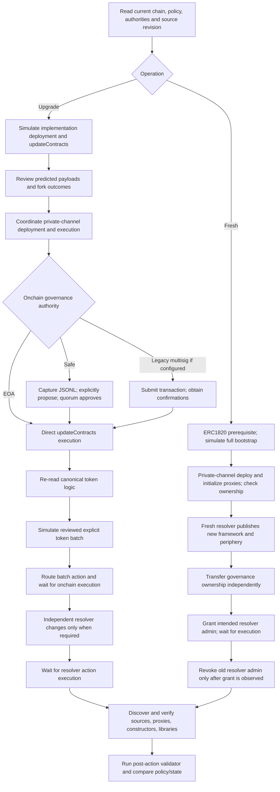

# Deployment tooling and Truffle migration

Maintained operator guide for **contracts 1.16.0**. Commands below run from
`packages/ethereum-contracts`. Production operations use Foundry scripts and the
thin wrappers in [`new-ops-scripts`](../new-ops-scripts); local tests use the
[dedicated fixture](../test/lib/deploy-framework.ts),
[JS deployer](../dev-scripts/deploy-test-framework.js) or
[Solidity deployer](../contracts/utils/SuperfluidFrameworkDeployer.t.sol).
There is no Truffle runner, injected-client compatibility layer or legacy script alias.

The [deployment inventory](deployment-inventory.md) is the **2026-11-10 evidence
record**, with RPC sources, observation blocks, addresses and unknowns. It is not
live configuration. The [frozen kickoff handoff](plans/2026-11-truffle-migration-handoff.md)
preserves the original scope, not current instructions; the approved implementation
and this guide supersede its old proposed interfaces and Nix-only instruction.

Deployment acceptance tests resolve Foundry executables from `PATH`, including
Nix CI shells. Set `FOUNDRY_BIN` only to override their executable directory.

## Supported capabilities and evidence

All 16 networks in [metadata](../../metadata/networks.json) are supported; deprecated
networks outside that inventory are not production targets. Re-read current state,
check RPC chain ID and review the exact source/compiler revision before an operation.
Metadata alone is neither code-presence proof nor authorization.

| Capability / disposition | Evidence and supported behavior |
| --- | --- |
| Fresh persistent deployment — simplified | [Table A](deployment-inventory.md#table-a--core-configuration): all 16 hosts are upgradeable. `framework.sh NETWORK fresh` creates a **new** upgradeable framework/resolver; it never resets an existing deployment. Unknown chain IDs require a reviewed [ChainPolicy](../foundry-scripts/utils/ChainPolicy.sol) entry. |
| Existing framework upgrade — simplified | [Tables A–D](deployment-inventory.md#table-a--core-configuration): preserve host/agreement/factory proxies, host forwarders/ACL, pool beacon, resolver entries, PPP and reward settings. Read immutables and IDA policy from chain, not fresh defaults. |
| Governance execution — supported | [Table B](deployment-inventory.md#table-b--governance-owners-and-resolver-admins): five testnets have EOA owners; eleven mainnets use Safe 1.3.0 (ten 2-of-4, Arc 2-of-3). [DeployUtils](../foundry-scripts/utils/DeployUtils.sol) routes direct calls, legacy multisig submissions or Safe payloads by actual authority. |
| Resolver administration — supported | [Table B](deployment-inventory.md#table-b--governance-owners-and-resolver-admins): seven EOA admins (testnets, xDai, Polygon), nine legacy Gnosis multisig admins; no observed resolver Safe. Governance owner differs from resolver admin on **every mainnet**. Safe resolver routing remains available, not assumed. |
| Governance implementation upgrade — supported with limit | Mainnet GovernanceII proxies are observed in [Table B](deployment-inventory.md#table-b--governance-owners-and-resolver-admins). `upgrade-governance` changes GovernanceII logic only; direct testnet TestGovernance is not a code-upgrade target. |
| Callback / whitelist / IDA preservation — supported | [A](deployment-inventory.md#table-a--core-configuration), [C](deployment-inventory.md#table-c--registered-agreements-and-ida-policy): Arc mainnet whitelist is false; Optimism mainnet/Sepolia IDA is active/32 slots, others frozen/256. Missing or malformed getters fail closed. Reviewed overrides are explicit below. |
| Token logic upgrade — simplified | `upgrade-tokens` accepts a reviewed explicit JSON address array **after framework execution**. Every token must belong to the host, be an upgradeable proxy, match the canonical UUID and have admin zero or the host. Automatic `ALL` discovery is not implemented. |
| Token deployment / listing — simplified | Permissionless ERC20 factory call or atomic pure/native deployment, followed separately by resolver listing. Listing requires explicit release; overwriting requires `ALLOW_UPDATE=1`. No implicit token-logic upgrade. |
| Forwarder rollout — simplified | [D](deployment-inventory.md#table-d--host-dependencies-factory-nfts-beacon-and-forwarders): distinguish deployed code, host trust and resolver publication. Deploy → verify → activate → wait for execution → register. Macro task still means **BlindMacroForwarder**. |
| Fresh auxiliary contracts / handover — simplified | Fresh includes GovernanceII, TOGA, reward configuration, BatchLiquidator, resolver/loader and forwarders. Governance ownership and resolver roles transfer independently, grant-before-revoke. |
| Verification / validation — supported with historical limits | Read-only JSON discovery and Foundry source verification include constructors, distinct linked libraries and proxy sources; explorer proxy association is not implemented. See historical-source/archival gaps below. Validator accepts explicit resolver/release and retired zero PoolMemberNFT. |
| Non-upgradeable / mocks / snapshots — covered by devchain tooling | No observed persistent non-upgradeable host justifies a production flag. `yarn testenv:deploy` retains local framework/default tokens/ETHx; fixture-only resets, mocks and snapshots are not production operations. |

### Fixed fresh defaults; upgrades preserve deployed state

[ChainPolicy.sol](../foundry-scripts/utils/ChainPolicy.sol) is the single fresh policy:

| Setting | Fresh value |
| --- | --- |
| Upgradeability / governance | Upgradeable only; deployer-owned GovernanceII proxy initially |
| Callback gas | 7,500,000 Fuji/Avalanche C; 8,500,000 xDai; 3,000,000 Ethereum/Scroll; 12,000,000 other supported networks |
| App whitelisting | False on testnets and Arc mainnet; true on other mainnets |
| IDA freeze / subscription slots | Optimism mainnet/Sepolia false/32; other persistent targets true/256 |
| Liquidation / patrician seconds | Testnets 3600/720; mainnets **14400/1800**, not the old computed 2880 |
| Reward / TOGA bond duration | New TOGA is reward address; minimum bond duration fixed at 7 days |
| Standard forwarders | CFA, GDA, BlindMacro deployed and trusted; ClearMacroForwarderV1WithPermit2 deployed on all, trusted only on mainnets |
| NFTs / pool | PoolAdminNFT retained; no restored flow NFTs or PoolMemberNFT deployment; host-owned pool beacon |
| Release / output | Framework, discovery and validator default `v1`; token list/unlist require explicit `RELEASE_VERSION`. Logs/native Foundry JSON/Safe JSONL replace sourced shell assignments. |

`upgrade` deliberately **always deploys** current host, CFA, IDA, GDA, factory,
SuperToken, PoolAdminNFT and pool implementations, including current linked
libraries, then routes **one** governance `updateContracts`. It is not a bytecode
comparator or an idempotent "upgrade only what changed" operation. It preserves
existing proxies/dependencies/state and does not publish resolver changes. An
ordinary second `upgrade` prepares another implementation set; native resume is
for the original interrupted transaction plan, not a new upgrade request.

Upgrade-only overrides are `CALLBACK_GAS_LIMIT`, `APP_WHITELISTING`, `IDA_FROZEN`
and `IDA_SLOTS` (1–256). Every difference from the deployed value
requires `REVIEWED_IMMUTABLE_OVERRIDE=true`. Review a fork simulation and protocol
impact first; that acknowledgment is not evidence that a change is safe. PPP,
reward, ACL state and resolver entries are never re-derived from fresh defaults.

## Authentication and side-effect boundaries

Prerequisites: installed workspace dependencies, compiled artifacts for the selected
revision, Foundry `forge`/`cast`/`anvil`, Node, Yarn, Bash and `jq`. Read-only
address discovery and `--plan` verification need no build or signing key.

- **RPC:** use canonical metadata network names. Shell priority is `RPC_URL` →
  `PROVIDER_URL_OVERRIDE` → `PROVIDER_URL_TEMPLATE` containing `{{NETWORK}}` →
  metadata `publicRPCs[0]`. Discovery additionally accepts `--rpc-url`. The
  inventory used `https://<network-name>.rpc.x.superfluid.dev`; wrappers do not
  silently select that private endpoint. Explicit exported env wins over
  package/parent `.env` defaults in wrappers which load them.
- **Framework:** default is simulation, **regardless of `SIMULATE`**. Only
  `--broadcast` or `--resume` enables sending. `PRIVATE_KEY` or encrypted Foundry
  account `WALLET_NAME` (default `sf-ops`) supplies the deployer. It never submits
  Safe proposals, including during broadcast. `SAFE_PAYLOADS_FILE` defaults to
  `.tmp/framework-safe-payloads.jsonl`; a new non-resume invocation truncates it.
  Archive reviewed payloads before starting another action.
- **Governance/resolver/custom-token/forwarder wrappers:** set **`SIMULATE=1`**
  for no broadcast/proposal. **Without it these wrappers are live commands**;
  a nonempty value, even `0`, means simulation where that convention is used.
  Signing uses `WALLET_NAME`. Governance/resolver Safe routes can invoke the
  proposer automatically in live mode; framework actions cannot.
- **Keystore:** `cast wallet import sf-ops --interactive` imports an encrypted
  account. Use the interactive password prompt or `KEYSTORE_PASSWORD_FILE`
  (recommended), `KEYSTORE_PASSWORD` (including an empty password), or
  `SF_KEYSTORE_PASSWORD_FILE`. Password files must be protected. Signing helpers
  scope `ETH_PASSWORD` to the signing subprocess; do not export it globally,
  because read-only `cast call` can break. No workflow requires mnemonic env.
- **Authorities:** simulations derive EOA/legacy multisig senders without a key.
  Framework resolver-role simulation needs explicit `DEPLOYER`. Set
  `RESOLVER_ADMIN` when more than one role member exists; it must actually hold
  `DEFAULT_ADMIN_ROLE`. Governance-owner identity never substitutes for resolver
  authority. A multisig submission can execute immediately if its threshold is
  met; do not assume it only queues a proposal.
- **Safe:** live proposal submission requires `SAFE_PROPOSER_PK` and, where
  required by the service, `SAFE_API_KEY`; `SAFE_TX_SERVICE_URL` selects a custom
  service and `SAFE_ORIGIN` labels the proposal. A proposer is not an execution
  quorum. `safe-ops.ts ... --dry-run` decodes payloads without signing/submitting.
  Confirm Safe, chain, target, value, operation, calldata and nonce before approval.
- **Explorers:** framework verifier defaults to keyless Sourcify. Etherscan is
  opt-in `--verifier etherscan` with `ETHERSCAN_API_KEY` or
  `ETHERSCAN_API_V2_KEY`; Blockscout requires `--verifier blockscout
  --verifier-url URL`. Verification sends source to explorers, not transactions.

### Actual deployment and execution order



Fresh resolver registration occurs during bootstrap, not during an upgrade. A
plain framework upgrade normally skips M/N; never bump resolver entries merely
because a Safe payload was prepared. Forwarder tasks perform an additional early
source verification, then activation/execution **before** resolver publication.

### Initialization and private-channel windows

The production script uses the **same proxy contract types** as deployed networks.
Proxy creation, `initializeProxy` and implementation initialization remain separate
transactions. Fresh host/governance/NFT initialization has ownership/linkage
postchecks, and implementations are castrated where compatible, but these checks
do **not** make bootstrap atomic or remove public-mempool front-running windows.
Use a private transaction channel for production bootstrap; inspect initialization
and ownership before handing over authority.

During upgrades the existing governance `updateContracts` **castrates host and
agreement implementations during execution**. Pre-castrating those implementations
makes execution revert. A third party initializing them while they wait can also
grief execution. Pre-review predicted deployment addresses/payloads on a fork and
coordinate actual implementation deployment with approved governance execution
through a private channel; do not leave publicly deployed implementations awaiting
an unprepared approval process. This inherited window is an explicit operational
limitation, not fixed by removal of Truffle. Pure/native custom-token deployment
uses a script-local helper to create **and initialize atomically**; it is not a
replacement proxy architecture for the framework.

## Operator recipes and expected results

These are command recipes, **not a transcript of live execution**. Address/hash
values depend on chain and deployer. Never execute live examples as part of PR
validation. Use the selected revision's existing artifacts; integration checks
are owned by the integration owner.

### 1. Keyless discovery and upgrade simulation

```bash
export NETWORK=eth-sepolia
export RPC_URL="https://${NETWORK}.rpc.x.superfluid.dev"
export RELEASE_VERSION=v1
node new-ops-scripts/info-print-contract-addresses.js "$NETWORK"
bash new-ops-scripts/framework.sh "$NETWORK" upgrade
```

Discovery prints JSON: `schemaVersion`, `network`, `chainId`, `release`,
`blockNumber`, `blockHash`, `addresses`, `contracts`, `errors`, `unsupported` and
`metadataContracts`; inspect `errors: []`, not just the exit status. Framework
prints Foundry's simulation and `Safe payloads (not submitted): ...`. Safe routing
prints `Payload only: review and explicitly submit with safe-ops.ts` and JSONL with
`safeAddress`, `to`, `value: "0"`, `data`, `operation: "0"`, `actionType`.
Simulated EOA "action executed" messages describe the simulation, not live state.

Use an explicit RPC local fork for transaction-bearing rehearsal. Review exact
payload target/calldata and before/after callback, whitelist, IDA slots/freeze,
PPP, reward, ACL, beacon and resolver values. A successful simulation alone does
not show that an unexecuted Safe action upgraded the framework.

### 2. Fresh deployment, handover and optional faucet

```bash
# Both commands below are non-broadcast by default.
bash new-ops-scripts/deploy-erc1820.sh "$NETWORK"
bash new-ops-scripts/framework.sh "$NETWORK" fresh
```

The prerequisite prints `ERC1820 already deployed at ...` or a funding/raw-transaction
plan ending `Simulation only: no funding or publishing. Raw transaction: ...`.
If the registry is absent, fresh fails before deployment. In an authorized live
bootstrap, add `--broadcast` to the prerequisite to fund its canonical signer up
to 0.1 native ETH-equivalent and publish the canonical presigned transaction; the
script never signs that raw registry transaction. Existing upgrades impose no
ERC1820 prerequisite. ERC777 hooks still require it even where current
initialization/TOGA ERC20 `bond()` can work without it (as observed on Arc).

Fresh simulation prints `HOST_ADDRESS`, `RESOLVER_ADDRESS`, `GOVERNANCE_ADDRESS`.
An authorized live fresh deployment uses the same command plus `--broadcast` and
protected keystore auth. Record the **broadcasted**, not merely predicted,
addresses, then export them. For handover, set real intended addresses first:

```bash
: "${HOST_ADDRESS:?Set the new deployed host}"
: "${RESOLVER_ADDRESS:?Set the new deployed resolver}"
: "${DEPLOYER:?Set the current authorized sender}"
: "${NEW_GOV_OWNER:?Set the intended governance owner}"
: "${NEW_RESOLVER_ADMIN:?Set the intended resolver admin}"
: "${OLD_RESOLVER_ADMIN:?Set the current resolver admin}"
export HOST_ADDRESS RESOLVER_ADDRESS DEPLOYER
bash new-ops-scripts/framework.sh "$NETWORK" handover-governance "$NEW_GOV_OWNER"
bash new-ops-scripts/framework.sh "$NETWORK" handover-acl "$NEW_GOV_OWNER"
bash new-ops-scripts/framework.sh "$NETWORK" grant-resolver-admin "$NEW_RESOLVER_ADMIN"
# Execute the reviewed grant onchain before simulating or broadcasting revocation.
bash new-ops-scripts/framework.sh "$NETWORK" revoke-resolver-admin \
  "$OLD_RESOLVER_ADMIN" "$NEW_RESOLVER_ADMIN"
```

These framework commands still only simulate unless individually given
`--broadcast`. Ownership transfer is not resolver transfer or SimpleACL transfer.
After grant execution, multiple admins normally exist: select an authorized
`RESOLVER_ADMIN` explicitly where needed. Re-read `owner()` and role membership,
then verify/validate the **new** resolver rather than metadata's old resolver.

Optional persistent **testnet-only** public-mint faucet/wrapper provisioning:

```bash
bash new-ops-scripts/framework.sh "$NETWORK" provision-test-token \
  'Migration USD' MIGUSD 6 1000000000
```

`MINT_LIMIT` is in underlying base units. Occupied resolver keys are refused;
provisioning is not an implicit part of a production upgrade.

### 3. Explicit broadcast/recovery and Safe review

Only on an operator machine, after review/private-channel coordination:

```bash
export WALLET_NAME=sf-ops
export KEYSTORE_PASSWORD_FILE="$HOME/.config/superfluid/keystore-password"
# Live transaction command: do not run during implementation/CI validation.
bash new-ops-scripts/framework.sh "$NETWORK" upgrade --broadcast
# Interrupted plan only: preserve identical action/arguments/source/signer/chain.
bash new-ops-scripts/framework.sh "$NETWORK" upgrade --resume
```

Preserve **both `broadcast/` and `cache/`** and the original revision. Native
Foundry artifacts contain transactions/receipts and support native `--resume`;
there is no bespoke state engine. Inspect receipts/nonces before resuming an
uncertain submission. A completed fresh resume sends nothing new; ordinary fresh
rerun is refused when its same-chain artifact exists. Explicitly archive native
artifacts only when intentionally creating a genuinely **new** framework, never
to bypass an interrupted-deployment guard. Resume is not governance confirmation:
a Safe payload still needs approval and execution after deployment transactions.

For a Safe framework action, save the reviewed JSONL outside the default file
before another action. Decode it without secrets:

```bash
npx ts-node new-ops-scripts/safe-ops.ts propose-file \
  --rpc-url "$RPC_URL" --payload-file .tmp/framework-safe-payloads.jsonl \
  --mode single --dry-run
```

Live proposal submission is a separate explicit use of that CLI **without**
`--dry-run` and with `SAFE_PROPOSER_PK`/service credentials. This signs/submits a
proposal; it does not execute it. Safe proposal success reports `Safe Tx Hash`
and `Nonce`. Check actual onchain execution before preparing the token batch:

```bash
: "${TOKEN:?Set one reviewed host-governed SuperToken proxy}"
bash new-ops-scripts/framework.sh "$NETWORK" upgrade-tokens "[$TOKEN]"
```

This simulates a separate routed batch against the **currently canonical** logic.
Use Foundry address-array syntax (`'[0xA,0xB]'`), not quoted JSON strings.
Safe-admin tokens (including ETHx/USDCx on eth-mainnet) instead use
`super-token-admin-action.sh`; they are not host-governed token batches.

Every policy difference requires `REVIEWED_IMMUTABLE_OVERRIDE=true`.
The wrapper checks RPC chain ID against NETWORK; only local Anvil tests may use
`ALLOW_LOCAL_CHAIN_ID_MISMATCH=1`. Fresh deployment on a chain with a metadata
host requires `ALLOW_EXISTING_FRAMEWORK=1`. A second non-resume broadcast upgrade
requires `NEW_UPGRADE=1`; normally use `--resume` for interrupted broadcasts.
Payload defaults are `.tmp/framework-<chainId>-<action>[-dry-run].jsonl`.
Simulated payloads cannot be proposed, and proposal RPC chain IDs must match.
`SAFE_PAYLOAD_SIMULATED` defaults to true in the shared Solidity emitter.
Wrappers set it false only in their broadcast/proposal path; do not manually
relabel a simulation. `safe-ops --dry-run` may display simulated payloads but
still checks the RPC chain binding. Proposal paths reject simulated payloads.
On native upgrade resume, implementation code is checked after remaining
deployment transactions complete and before the saved payload is displayed.

Use reviewed bounded arrays for larger batches. Do not reuse a pre-execution
simulation that still referenced the old canonical logic.

### 4. Deploy, list, unlist and governance actions

Permissionless ERC20 wrapper creation has no admin/proposer route. Set real
`UNDERLYING`, `NAME`, `SYMBOL` and a funded signer first. Preview the factory call
with `cast call`; its returned address is a simulation, not a deployed token:

```bash
: "${HOST_ADDRESS:?Set the verified host}"
: "${UNDERLYING:?Set the ERC20 address}"
: "${NAME:?Set wrapper name}"
: "${SYMBOL:?Set wrapper symbol}"
FACTORY=$(cast call "$HOST_ADDRESS" 'getSuperTokenFactory()(address)' --rpc-url "$RPC_URL")
cast call "$FACTORY" 'createERC20Wrapper(address,uint8,string,string)(address)' \
  "$UNDERLYING" 1 "$NAME" "$SYMBOL" --rpc-url "$RPC_URL"
# LIVE: read the created address from receipt/event, not a stale prediction.
cast send "$FACTORY" 'createERC20Wrapper(address,uint8,string,string)(address)' \
  "$UNDERLYING" 1 "$NAME" "$SYMBOL" --rpc-url "$RPC_URL" --account sf-ops
```

Direct `cast send` uses Foundry's interactive password prompt unless you explicitly
scope its password-file option/env; wrapper password helpers do not wrap arbitrary
shell commands. Native/pure deployments use their atomic helper instead:

```bash
SIMULATE=1 bash new-ops-scripts/deploy-custom-super-token.sh "$NETWORK" \
  pure 'Migration Pure' MIGPURE 1000000000000000000
SIMULATE=1 bash new-ops-scripts/deploy-custom-super-token.sh "$NETWORK" \
  native 'Migration Native' MIGNATIVE
```

Expected Foundry marker: `SIMULATION COMPLETE`; no deployed token exists until
an authorized live run. Choose native symbol explicitly; there is no old
`NATIVE_TOKEN_SYMBOL`/implicit wrapper-reset branch. For an already deployed token:

```bash
: "${TOKEN:?Set the deployed SuperToken address}"
RELEASE_VERSION=v1 SIMULATE=1 bash new-ops-scripts/resolver-token.sh "$NETWORK" list "$TOKEN"
RELEASE_VERSION=v1 SIMULATE=1 bash new-ops-scripts/resolver-token.sh "$NETWORK" unlist MIGPURE
SIMULATE=1 bash new-ops-scripts/resolver-token.sh "$NETWORK" register MIGUSD "$UNDERLYING"
SIMULATE=1 bash new-ops-scripts/gov-action.sh "$NETWORK" setTokenMinimumDeposit "$TOKEN" 424242
```

List derives `symbol()` unless an override argument follows the token; the key is
`supertokens.RELEASE.SYMBOL`. Registration uses `tokens.NAME`. Unlist deliberately
clears its key with overwrite enabled. Explicit replacement uses `ALLOW_UPDATE=1`;
without it, an occupied different value fails. Resolver reset is
`resolver-token.sh NETWORK reset RELEASE CONFIRM_RELEASE`, with **matching**
confirmation; it performs two separately authorized zero writes for
`Superfluid.RELEASE` and `TestGovernance.RELEASE`, not an atomic framework deletion.
If interrupted, inspect each key and retry only missing work. Proposal/submission
success is not resolver execution or indexer freshness; the temporary transfer
helper was retired, so automatic indexer refresh is not promised.

### 5. Forwarder rollout, verify and validate

```bash
SIMULATE=1 bash tasks/deploy-cfa-forwarder.sh "$NETWORK" all
# After the separately reviewed activation has actually executed, resume publication:
ALLOW_UPDATE=1 SIMULATE=1 bash tasks/deploy-cfa-forwarder.sh "$NETWORK" register
bash new-ops-scripts/verify-framework.sh "$NETWORK" --plan
# Source verification contacts explorers, but sends no transactions:
bash new-ops-scripts/verify-framework.sh "$NETWORK"
RELEASE_VERSION=v1 yarn hardhat run new-ops-scripts/validate-deployment.ts --network ops
```

For a fresh/custom resolver, export `RESOLVER_ADDRESS` and `HOST_ADDRESS` for
wrappers/discovery, and `RPC_URL` for Hardhat `ops`; verifier also accepts
`--resolver`, `--host`, `--release`. Address report/plan `--block NUMBER` pins all reads.
Explicit host/resolver overrides take precedence over metadata throughout forwarder
trust checks, idempotence checks, activation and registration. Discovery `--host`
takes precedence over `HOST_ADDRESS`.
Forwarder tasks accept `all|deploy|verify|activate|register`; GDA/macro
use their corresponding task paths. A missing forwarder requires its distinct
`CFAFWD_DEPLOYER_PK`, `GDAFWD_DEPLOYER_PK` or `MACROFWD_DEPLOYER_PK`, even for a
deployment simulation. Simulation then stops before activation/registration if
bytecode does not yet exist. An existing trusted forwarder needs no deployment key.
Registration is blocked while activation is pending. Rerun only `register` after
execution; verification failures are separately resumable and keep a failing exit.
The CFA, GDA and BlindMacro tasks export `SKIP_GRANT_PROVIDER=1` for the shared
rollout library: ClearMacro provider-role grants never apply to these forwarders.

Verifier `--plan` prints JSON `mode: "plan"`, compiler-source targets, encoded
constructors, linked libraries, `errors` and `unsupported`. Actual verification
prints aggregate `results` and `failedCount`; success requires zero errors,
verification failures **and unsupported implementations**. Retry after resolving
failures; already-verified contracts are recognized by forge/explorers. The
validator prints `ASSERTING:` then `ASSERTION PASSED!` for factory/token/pool UUIDs,
CFA trust, canonical factory/NFT logic, NFT URI, agreement registration/types and
pool beacon. Failure exits nonzero; it is not an exhaustive economic/security audit.

## Explicit gaps and exact failures

Quoted errors are source-defined failure messages, not claims they were exercised
in this documentation pass. Preflight failures below precede deployment/action
submission; a verification aggregate failure can occur after explorer requests.

| Gap / safety boundary | Exact error or reporting behavior | Recovery / rationale |
| --- | --- | --- |
| Automatic token discovery | `ALL token discovery is not implemented. Supply a reviewed explicit address array after framework upgrade execution.` | Supply reviewed explicit arrays; no unreviewed filtering/skip-file engine. Empty arrays fail `Explicit token list required; ALL discovery is not implemented`. |
| Explorer proxy association | `--verify-proxy explorer association is not implemented. Proxy SOURCE verification is included automatically; link implementations in the explorer separately.` | Use explorer-specific association separately. Old broken plugin wrapper is removed. |
| Historical token/source mismatch | `unsupported` entries in discovery/plan; actual verification exits nonzero and counts them in `failedCount` | Historical fTUSDx logic cannot be verified with current sources. Use matching historical source/compiler/settings; arbitrary underlying ERC20s/external automation schedulers are reported, not verified. `--skip-tokens` deliberately narrows verification; it is not complete token verification. |
| Missing archive history | Component errors in `errors`, nonzero exit; beacon constructor must be its **original** implementation | Use archive RPC or `--constructor-args-file FILE`, JSON mapping deployed address to ABI-encoded constructor hex. Do not substitute today's beacon implementation. Inventory retains Avalanche C/BSC historical unknowns. |
| Unknown fresh chain | `Unsupported chain: add a reviewed ChainPolicy entry first` | New-chain policy requires review, not generic guessed defaults. |
| Fresh registry absent | `ERC1820 missing: run deploy-erc1820.sh before deploying framework` | Explicit registry prerequisite; upgrades do not impose it. |
| Fresh with existing resolver override | `Fresh creates a new resolver; use resolver-set-key for an existing resolver` | Remove override only for a genuinely new resolver; mutate existing keys through authorized resolver operations. |
| Repeated fresh broadcast | `Fresh broadcast artifacts already exist. Use --resume to finish them; archive the broadcast/cache artifacts explicitly before an intentional new framework deployment.` | Resume original plan, not fresh reset. |
| Governance code upgrade | `Governance logic upgrade requires GovernanceII proxy` | Direct TestGovernance is rejected with this message. Use separately reviewed governance replacement, not code upgrade of a non-proxy. |
| Token preflight | `Token belongs to another host`; `Token admin is not governed by this host`; `Token is not an upgradeable proxy`; `Token implementation UUID mismatch` | Remove incompatible token from the reviewed batch; do not bypass authority/UUID guards. |
| Policy changes | `Callback gas change requires REVIEWED_IMMUTABLE_OVERRIDE=true`; `Whitelisting change requires REVIEWED_IMMUTABLE_OVERRIDE=true`; `IDA freeze change requires REVIEWED_IMMUTABLE_OVERRIDE=true`; `IDA slots change requires REVIEWED_IMMUTABLE_OVERRIDE=true` | Preserve every onchain value unless explicitly reviewed; bad/missing IDA getters propagate failure, never default to legacy policy. |
| Resolver authority | `Expected one resolver admin; select authorized RESOLVER_ADMIN explicitly`; shell simulation: `Set RESOLVER_ADMIN explicitly when resolver does not have exactly one admin`; `RESOLVER_ADMIN does not hold DEFAULT_ADMIN_ROLE` | Select actual role holder, not governance owner or last enumerable member. |
| Overwrite / release | `ALLOW_UPDATE=1 required`; `Set RELEASE_VERSION explicitly (e.g. v1)` | Deliberate overwrite and release selection; no default `test` listing. |
| Grant-before-revoke | `Grant must execute before revocation` | Observe successful role grant before revoking old admin. |
| Forwarder publication | `Registration blocked: activation has not executed onchain. A Safe proposal is not execution.` | Wait for activation execution, then rerun `register`. |
| Unknown admin contract | `Unknown admin contract type` | EOA, legacy multisig and Safe are the implemented routes; no generic contract-account fallback. |
| Retired framework env | `NAME is retired. Use explicit framework operations and reviewed policy overrides; see README Persistent framework deployment and upgrades.` | Remove the old env, even if set to `0` or empty; use the table below. |
| Public initialization windows | No atomic-bootstrap guarantee; see [private-channel windows](#initialization-and-private-channel-windows) | Coordinate private deployment/execution; tooling cannot fix this inherited contract behavior. |

## Complete legacy operation and caller disposition

Paths in the old column are package-relative historical identifiers, **not live
links**. Every top-level legacy operation, task wrapper and deployment option is
accounted for. **Supported** preserves the capability; **simplified** preserves
an outcome with a smaller explicit interface; **retired** removes it with no shim;
**not implemented** is an explicit unsuccessful path, never a successful no-op;
**devchain** means covered by dedicated local/test tooling. Manual operator use
remains a requirement even without CI callers.

Here `framework` = `bash new-ops-scripts/framework.sh NETWORK`, `resolver-token` =
`bash new-ops-scripts/resolver-token.sh NETWORK`, `gov-action` =
`bash new-ops-scripts/gov-action.sh NETWORK`.

### All 30 legacy operations

| Old `ops-scripts/` entry | New command / disposition | Reason |
| --- | --- | --- |
| `deploy-framework.js` | `framework fresh` / `framework upgrade` — simplified | Separate new deployment from implementation upgrade; no reset/conditional bytecode matrix. |
| `deploy-aux-contracts.js` | Included in fresh plus explicit handover — simplified | GovernanceII, PPP, TOGA/reward, BatchLiquidator belong to bootstrap; no separate community-deployment matrix. |
| `deploy-deterministically.js` | `deploy-deterministic-forwarder.sh NETWORK CONTRACT`; Loader in fresh — simplified | Retain supported deterministic forwarders; no force/deterministic Loader replacement. |
| `deploy-erc1820.js` | `deploy-erc1820.sh NETWORK [--broadcast]` — supported | Canonical presigned registry funding/publication is explicit. |
| `deploy-mfa.ts` | `dev-scripts/deploy-mfa.ts` — devchain | Already ethers; hardcoded local tester is not production. |
| `deploy-super-token.js` | ERC20 factory `cast send` or custom native helper, then resolver list — simplified | Deploy/list/logic upgrade are separate; do not reset an existing wrapper implicitly. |
| `deploy-test-environment.js` | `yarn testenv:deploy`, local JS/Solidity fixture — devchain | Local framework/default tokens/ETHx remain; persistent testnet is fresh + optional faucet. |
| `deploy-test-token.js` | Fixture helpers; `framework provision-test-token NAME SYMBOL DECIMALS MINT_LIMIT` — simplified | Explicit persistent testnet faucet; refuses occupied keys, no production mintable-token toggle. |
| `deploy-unlisted-super-token.js` | Permissionless factory `createERC20Wrapper` call — simplified | Listing is optional and independent; no new deploy SDK layer. |
| `deploy-unlisted-pure-super-token.js` | `deploy-custom-super-token.sh NETWORK pure NAME SYMBOL SUPPLY_BASE_UNITS` — simplified | Atomic custom initialization; explicit supply in base units. |
| `gov-authorize-app-deployer.js` | `gov-action setAppRegistrationKey DEPLOYER [EXPIRATION] [KEY]` — supported | Legacy host fallback remains live; default uint64-max expiry and `k1` preserved. SimpleACL grant is not equivalent. |
| `gov-set-3Ps-config.js` | `gov-action set3PsConfig TOKEN LIQUIDATION PATRICIAN` / `clear3PsConfig TOKEN` — supported | Explicit clear replaces special both-zero interpretation. |
| `gov-set-reward-address.js` | `gov-action setRewardAddress TOKEN REWARD` / `clearRewardAddress TOKEN` — supported | Explicit set/clear, zero token still means default scope. |
| `gov-set-token-min-deposit.js` | `gov-action setTokenMinimumDeposit TOKEN VALUE` — supported | Existing routed governance action. |
| `gov-set-trusted-forwarder.js` | `gov-action enableTrustedForwarder TOKEN FORWARDER` / `disableTrustedForwarder` — supported | No truthy 1/0 ambiguity; preserve default/token scope and execution gate. |
| `gov-transfer-framework-ownership.js` | `framework handover-governance OWNER`, `grant-resolver-admin ADMIN`, `revoke-resolver-admin OLD NEW` — simplified | Separate authorities, grant must execute before revoke. |
| `gov-upgrade-governance.js` | `framework upgrade-governance` — supported | GovernanceII implementation only, not direct TestGovernance. |
| `gov-upgrade-super-token-logic.js` | `framework upgrade-tokens '[0xA,0xB]'` — simplified; `ALL` not implemented | Separate action after framework execution; canonical host-governed proxies only. |
| `info-inspect-account.js` | `cast call`, sdk-core, explorer — retired | No maintained report CLI; removed runner/path is the deliberate failure. |
| `info-list-apps.js` | Query `AppRegistered` logs/subgraph — retired | No duplicate report layer. |
| `info-print-contract-addresses.js` | `node new-ops-scripts/info-print-contract-addresses.js NETWORK` — simplified | JSON snapshot, not sourced shell assignments. |
| `info-scan-deployments.js` | `cast logs`, explorer/subgraph event queries — retired | Metadata is not discovery of unknown deployments; no automatic scanner promised. |
| `info-show-protocol.js` | Address JSON plus cast/sdk-core/explorer — retired | Full legacy report not reproduced. |
| `resolver-list-super-token.js` | `RELEASE_VERSION=v1 resolver-token list TOKEN [SYMBOL]` — simplified | Exact release/symbol namespace, explicit overwrite. |
| `resolver-register-token.js` | `resolver-token register NAME TOKEN` — supported | `tokens.NAME` via existing resolver setter. |
| `resolver-reset-deployment.js` | `resolver-token reset RELEASE CONFIRM_RELEASE` — simplified | Two explicit zero writes, matching confirmation; not atomic. |
| `resolver-set-key-value.js` | `resolver-set-key.sh NETWORK KEY ADDRESS` — supported | Existing admin routing and overwrite guard. |
| `resolver-unlist-super-token.js` | `RELEASE_VERSION=v1 resolver-token unlist SYMBOL` — supported | Explicit release-qualified clearing. |
| `tmp-trigger-token-transfer.js` | None — retired | Temporary indexer-refresh helper deliberately removed; automatic refresh is not promised. |
| `validate-deployment.ts` | Relocated `new-ops-scripts/validate-deployment.ts`, Hardhat `ops` network — supported | Explicit resolver/release; no fixed metadata-v1 target or Truffle globals. |

### Task wrappers, internal helpers and package commands

| Old surface | Replacement / disposition | Reason |
| --- | --- | --- |
| `tasks/deploy-cfa-forwarder.sh` | Same path + phases — simplified | Deterministic CFA deploy → verify → activate → execution → register. |
| `tasks/deploy-gda-forwarder.sh` | Same path + phases — simplified | Same GDA sequence, independent vanity signer. |
| `tasks/deploy-macro-forwarder.sh` | Same path + phases — simplified | Same sequence for **BlindMacroForwarder**, not ClearMacro substitution. |
| `tasks/etherscan-verify-framework.sh` | `new-ops-scripts/verify-framework.sh NETWORK [--plan]` — simplified | Native forge constructors/libraries/proxies, aggregate failure; no Truffle JSON mutation. |
| `tasks/etherscan-verify-proxies.sh` | Proxy source included in framework verifier; association `--verify-proxy` explicitly not implemented | Old plugin interface already unsupported; no successful placeholder wrapper. |
| `ops-scripts/libs/common.js`, `truffleScriptRunnerFactory.js`, `.eslintrc.js` | Removed — retired | No SDK loader, eval runner, stack detection, artifact/web3 globals or runtime compatibility mode. |
| `ops-scripts/libs/getConfig.js` | `ChainPolicy.sol` for fresh, current-chain getters for upgrades — simplified | Preserve real chain policy, discard Truffle/fixture default precedence. |
| Contracts `run-truffle`, `build:contracts:truffle`, disabled Truffle deployment test | Hardhat/Foundry builds/tests — retired | No disabled aliases or dormant Truffle entry points. |
| `test:deployment:scripts-js-hardhat`, `test:deployment:scripts-bash` | Maintained Foundry/Node/local-fork regressions — simplified | Port real deployment/admin/immutable/proxy/recovery safety, not native/injected runner smoke tests. |
| Root `build-essentials:js-sdk`, `build-for-contracts-dev:js-sdk`; js-sdk build/test/dev/watch/coverage/testenv wrappers | sdk-core workspace, explicit local deployer — retired | js-sdk is not active workspace/build/test/publication; no drop-in API shim. |
| `truffle-config.js`, SDK configs, Truffle/Web3 Hardhat plugins | Hardhat/Foundry config and explicit providers — retired | No HDWalletProvider/Truffle CLI/plugin/runtime dependency. Supported sdk-core Web3 providers remain. |

### Every framework option and shared environment family

Old JS option names and their env spelling are listed together where equivalent.
The framework wrapper **rejects** its retired env variables if present, not only
when truthy. Old programmatic options and removed scripts have no compatibility
entry point. Non-framework wrappers do not promise to diagnose every stale env.

| Old option / env | New surface / disposition | Reason |
| --- | --- | --- |
| `isTruffle`, `DISABLE_NATIVE_TRUFFLE` | None — retired | No runtime detection/native/injected mode. |
| `web3`, common `ethers` injection | Explicit RPC/provider; fixture provider locally — simplified | No generic client/options bag. |
| `from` | `DEPLOYER` for simulation; keystore/`PRIVATE_KEY` for supported broadcast wrappers — simplified | Explicit sender; no first-unlocked-account assumption. |
| `newTestResolver`, `CREATE_NEW_RESOLVER` | `fresh` creates new resolver — simplified | No random existing-resolver replacement. |
| `useMocks`, `USE_MOCKS` | Local contract fixture — devchain | Production mocks rejected. |
| `nonUpgradable`, `NON_UPGRADABLE` | Local contract fixture — devchain; production retired | 16/16 persistent hosts upgradeable. |
| `appWhiteListing`, `ENABLE_APP_WHITELISTING` | Fresh chain policy; upgrade `APP_WHITELISTING` — simplified | Preserve observed Arc exception, not boolean coercion. |
| `appCallbackGasLimit`, `APP_CALLBACK_GAS_LIMIT` | Fresh chain policy; upgrade `CALLBACK_GAS_LIMIT` — simplified | Numeric immutable, not old unreliable boolean env coercion. |
| `ALLOW_DECREASE_APP_CALLBACK_GAS_LIMIT` | `REVIEWED_IMMUTABLE_OVERRIDE=true` — simplified | Explicit acknowledgment also guards whitelist flips and IDA unfreeze. |
| `resetSuperfluidFramework`, `RESET_SUPERFLUID_FRAMEWORK` | Separate `fresh`/`upgrade`; local fixture reset — retired production knob | No destructive reset disguised as repeat deployment. |
| `protocolReleaseVersion`, `RELEASE_VERSION` | `RELEASE_VERSION` / discovery `--release` — supported | Framework defaults `v1`; list/unlist require explicit release, never runner default `test`. |
| `outputFile`, `OUTPUT_FILE` | Native broadcast/cache, logs, JSON discovery, `SAFE_PAYLOADS_FILE` — simplified | No executable shell-assignment output. |
| `newSuperfluidLoader`, `NEW_SUPERFLUID_LOADER` | Loader included only in fresh — retired force knob | Forced/deterministic Loader replacement not retained; existing resolver entries can be explicitly administered. |
| `WITHOUT_ERC1820` | Fresh preflight + prerequisite command — retired | ERC777 registry functionality required for full fresh deployment; no new upgrade prerequisite. |
| `NO_NEW_GOVERNANCE`, `DISABLE_TEST_GOVERNANCE` | Fresh GovernanceII, fixture locally — retired production knobs | No production TestGovernance selector. |
| `IS_HARDHAT` | Normal local fixture/config — retired | No linking/gas runtime branches. |
| `RESOLVER_ADDRESS` | Explicit resolver operations/discovery/validator — supported; not a fresh override | Fresh creates its own resolver; existing operations must target actual authority. |
| `IS_TESTNET` | Canonical chain policy — retired override | No env truthiness determines deployment owner/type. |
| `GOVERNANCE_ADMIN_TYPE` | Onchain owner autodetection — simplified | Safe vs EOA determined from actual owner, no forced legacy-multisig mainnet assumption. |
| `RESOLVER_ADMIN_TYPE` | Onchain role/admin autodetection, authorized `RESOLVER_ADMIN` if ambiguous — simplified | No last-role-member fallback; independent governance/resolver authority. |
| `SAFE_API_KEY` | Safe proposer service auth — supported | Operator credential, not required for keyless payload generation. |
| `PROVIDER_URL_OVERRIDE` | Same override, below `RPC_URL` priority — supported | Real operator RPC override remains. |
| `PROVIDER_URL_TEMPLATE` | Same `{{NETWORK}}` template — supported | Canonical network interpolation. |
| Network/alias/`DEFAULT_` `PROVIDER_URL` | `RPC_URL` or shared RPC helper — simplified | Truffle aliases/prefix matrix removed. |
| Network/alias/`DEFAULT_` `MNEMONIC` | Encrypted Foundry keystore — retired mnemonic interface | No mnemonic compatibility shim or dependence on manual CI signing secret. |
| Network/alias/`DEFAULT_` `PRIVATE_KEY` | `WALLET_NAME`; framework/prerequisite also accept plain `PRIVATE_KEY` — simplified | No HDWalletProvider alias lookup; prefer encrypted account. |
| Network/alias/`DEFAULT_` `GAS_PRICE` | Native Foundry fee configuration — simplified | No Truffle-prefixed aliases or arbitrary extra framework flags. |
| Network/alias/`DEFAULT_` `MAX_FEE_PER_GAS` | Native Foundry fee configuration; deterministic deployer `MAX_FEE_PER_GAS` — simplified | No alias inheritance; operator controls supported native interface. |
| Network/alias/`DEFAULT_` `MAX_PRIORITY_FEE_PER_GAS` | Native Foundry fee configuration; deterministic deployer `MAX_PRIORITY_FEE_PER_GAS` — simplified | No blanket translation of old env to framework argv. |
| `PRIVATE_PROVIDER_PORT` | Explicit local `RPC_URL` — devchain | No production private-provider network preset. |
| `SOLC` | Pinned Hardhat/Foundry compiler settings; verifier `--compiler-version` where appropriate — retired Truffle knob | Compiler pin remains, no native Truffle compilation selector. |
| `ETHERSCAN_API_V2_KEY`, `ETHERSCAN_API_KEY` | Framework verifier Etherscan auth — supported | Keyless Sourcify is default; V2 key works without alias matrix. |
| `POLYGONSCAN_API_KEY`, `SNOWTRACE_API_KEY`, `OPTIMISTIC_API_KEY`, `BSCSCAN_API_KEY`, `ARBISCAN_API_KEY`, `GNOSISSCAN_API_KEY`, `CELOSCAN_API_KEY`, `BASESCAN_API_KEY`, `ZKEVM_POLYGONSCAN_API_KEY`, `SCROLLSCAN_API_KEY` | Unified framework verifier key or explicit verifier/URL — simplified | Old Truffle per-explorer key aliases not automatically translated. |
| `DRY_RUN` / `dryRun` | Framework default simulation; other wrappers `SIMULATE=1` — simplified | Framework rejects old env; never infer all wrappers default to dry-run. |

### Other legacy script/task options

| Old surface | Replacement / disposition | Reason |
| --- | --- | --- |
| `GOV_LIQUIDATION_PERIOD`, `GOV_PATRICIAN_PERIOD`, `TOGA_MIN_BOND_DURATION` | Fixed fresh chain PPP / seven-day TOGA bond; governance PPP set/clear separately — simplified | Bootstrap not an arbitrary policy bag; upgrades preserve deployed settings. |
| Deterministic `NONCE` | Nonce-zero vanity deployer — simplified | No arbitrary nonce branch; expected address/code checks remain. |
| `DETERMINISTIC_DEPLOYER_PK`, `CFAFWD_DEPLOYER_PK`, `GDAFWD_DEPLOYER_PK`, `MACROFWD_DEPLOYER_PK` | Generic deterministic helper / distinct task keys — supported | Preserve deterministic identity, independent funder/admin `WALLET_NAME`. |
| Deterministic `GAS_PRICE`, `GAS_LIMIT`, `EST_TX_COST` | Auto-estimation, optional `GAS_LIMIT`, `MAX_FEE_PER_GAS`, `MAX_PRIORITY_FEE_PER_GAS`, `EST_TX_COST` — simplified | EIP-1559 funding/fee overrides replace legacy gas-price calculation. |
| `VERIFIERS`, `SKIP_VERIFY` | Forwarder verifier selection/skip; framework `--verifier`/`--verifier-url` — simplified | No Truffle verification plugin; simulation skips explorer verification. |
| `RESET_TOKEN`, `resetToken` | Existing state read + deliberate `ALLOW_UPDATE=1` for resolver replacement — simplified | No implicit wrapper replacement/logic upgrade. |
| `NATIVE_TOKEN_SYMBOL` | Explicit native helper `NAME SYMBOL` — simplified | No implicit network-symbol deployment branch. |
| `REGISTRATION_KEY`, missing expiration | `gov-action setAppRegistrationKey DEPLOYER [EXPIRATION] [KEY]` — supported | `k1` and uint64-max defaults preserved; SimpleACL is separate. |
| Token `SUPER_TOKEN_LOGIC` / `superTokenLogic`, `EXTRA_PAST_SUPER_TOKEN_LOGICS` | Current canonical factory logic only — retired | No arbitrary logic selection/history filtering inside upgrade command. |
| Token `BATCH_SIZE`, `MAX_ITEMS`, `SKIP_ITEMS` | Operator-reviewed explicit bounded arrays — retired | No hidden discovery/pagination/batch selection. |
| `skipTokensFile`, documented `SKIP_TOKENS_FILE` but actual `SKIP_OUTPUT_FILE`, token `outputFile`/`OUTPUT_FILE` | Reviewed arrays, native/Safe artifacts — retired | Do not reproduce old naming bug or file-driven discovery state. |
| Address report `skipTokens`/`SKIP_TOKENS`, `OUTPUT_FILE` | `--skip-tokens`; capture JSON stdout explicitly — simplified | No sourced env output; release and target are explicit. |
| `TESTENV_SNAPSHOT_VARS`, comma-separated fixture token symbols | Dedicated local deployer/test snapshot APIs — devchain | No production filesystem snapshot contract; persistent faucet is explicit. |
| Old `npx truffle exec ... : ARGS`, callback argv/options | Named bash/Node/Foundry commands — retired | No colon separator, global mutation, programmatic compatibility alias. |

## CI, evidence and remaining Truffle references

Manual deployment/listing/generic-operation workflows now **simulate only** using
metadata RPCs, no signing/proposer/explorer/AWS secrets. Deployment workflows
upload native simulation plans/Safe payload artifacts; actual broadcasts stay on
operator machines. The generic workflow dispatches supported operations, not an
arbitrary legacy script path. Verify workflow uses keyless plans. Secrets only
referenced by historical `workflow_dispatch` jobs may never have existed; their
presence was not tested and is not a migration prerequisite. Automatically
triggered workflow credentials were assumed available by the user; no new secret
was provisioned. The reusable dry-run workflow has no checked-in caller established
by discovery; its name alone is not an execution history claim.

Automatic contracts/sdk-core/subgraph/release builds consume Hardhat/Foundry
artifacts and exclude retired js-sdk. ABI bundle/subgraph generation retain #2257's
missing/ambiguous-artifact rejection and stable exports. CI/test assertions that
`build/truffle` is **absent** intentionally contain the string. Historical changelog
entries, frozen plans, this migration table, vendored OpenZeppelin 2017 audit
reports and hot-fuzz README historical examples are history/migration material,
not active Truffle callers; do not erase history just to make a text search empty.
Removed legacy regression modes were native vs
injected runtime smoke, mocks/non-upgradeable/reset branches; maintained coverage
protects policy preservation, admin payload correctness, proxy safety, initialization
postchecks, token authorization, overwrite refusal, no-secret simulation and resume.

Validated **without Nix** on Foundry **1.8.3** (`cae51ad…`), Node **26.8.2**,
Yarn **4.18.0**, and pinned solc **0.8.35**. Integrated acceptance passed the
Hardhat and Foundry contract suites, five ABI regressions, framework lifecycle/
native-resume tests, EOA/Safe upgrade forks on Optimism Sepolia, Ethereum,
Optimism and Arc, payload/verification-plan tests, sdk-core build/tests, lint,
syncpack and contracts TypeScript. Package dry-run contained Hardhat artifacts
and both ABI bundles, with no Truffle files. ShellCheck was not installed;
`bash -n` checked shell syntax. No live transactions or proposals were submitted.

## Consumer migration: contracts 1.16.0

**Breaking removal:** published `build/truffle/*.json` and Truffle runtime/config
entry points are gone, without flat-path aliases. ABI-only callers can replace:

```js
// Old: @superfluid-finance/ethereum-contracts/build/truffle/ISuperToken.json
const {abi} = require('@superfluid-finance/ethereum-contracts/build/hardhat/contracts/interfaces/superfluid/ISuperToken.sol/ISuperToken.json');
```

`build/bundled-abi.js` and `build/bundled-abi.json` filenames/exports remain supported;
fully qualified `build/hardhat/contracts/<source>.sol/<Contract>.json`, contract
sources and local `dev-scripts` remain published. Web3 applications can still
construct contracts from `.abi`; changing JSON paths does **not** restore Truffle
`networks`, deployment addresses, `deployed()`/`at()`, linking, BN/receipt or decoded
log abstractions. Read addresses from metadata/resolver/onchain state; use
ethers/viem/Foundry for deployment and library linking. Migrate old script callers
using the tables above, not `run-truffle` aliases.

`@superfluid-finance/js-sdk` implementation/tests/workspace/build/publication are
retired; only its [migration guide](../../js-sdk/README.md) and license remain.
This PR does **not** deprecate or unpublish npm releases. Do not pair old js-sdk
with contracts 1.16.0. Replace `new Framework(...); initialize()` with sdk-core
`Framework.create({chainId, provider, protocolReleaseVersion: 'v1', ...})`; pass
signers explicitly for Operation `.exec(signer)`. Use `loadSuperToken`,
`cfaV1`/`idaV1`/`gdaV1`, Operation batches and Query/ethers event APIs. There is no
drop-in User/gas-report/custom-loader shim or sdk-core `createERC20Wrapper` helper:
wrapper deployment is a factory call. sdk-core's Web3-provider compatibility remains;
Hardhat no longer injects global `web3`/`artifacts`.

### Known external artifact consumers (dated discovery, not exhaustive telemetry)

The 2026-11-10 caller research searched accessible indexed GitHub default branches;
a broad search hit the 100-result cap and private/unindexed users were not observable.
Known examples needing their **own** dependency/import migration before upgrading:

| Consumer / evidence | Required action |
| --- | --- |
| [superfluid-sentinel runtime](https://github.com/superfluid-org/superfluid-sentinel/blob/06fae457c42914bcf813916a90a6c004d152965d/src/web3client/contracts.js#L1), operator/test utilities | Replace flat IResolver/host/token/governance/agreement/BatchLiquidator/TOGA/pool artifact imports with qualified Hardhat `.abi` imports. Web3 itself need not be removed. |
| [kasparkallas/superapi Wagmi config](https://github.com/kasparkallas/superapi/blob/42d7946f3e07b8e9d53a6eccd2e37d4f461cb00e/wagmi.config.ts) | Replace flat SuperfluidPool path; bundled ABI remains supported. |
| [d10r/gda-activity](https://github.com/d10r/gda-activity/blob/034839d30b431f8cdb5f761b7b0e6ba88b02089a/app.js) | Migrate GDAv1Forwarder, IGeneralDistributionAgreementV1, ISuperfluidPool and TestToken flat imports. |
| [d10r/sf-macro-forwarder-demo](https://github.com/d10r/sf-macro-forwarder-demo/blob/4f9eaa81bc0ca8af390a84641538e6b727c2325a/app.js) | Review stale `MacroForwarder` contract identity as well as artifact layout; do not silently map to a different forwarder. |
| [Philotheephilix/computepool](https://github.com/Philotheephilix/computepool/blob/902de50d167bb2df0de2f079f1aff0d3ce96de1d/scripts/finish_superfluid_demo.py) | Update Python artifact directory/schema assumptions if installing 1.16.0; installed version/runtime was unknown. |
| Vendored historical monorepo copies | Search hits establish copied old loaders, not current npm-latest use; no claim all external consumers are migrated by this PR. |
