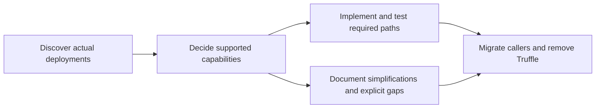

> **Iteration plan** — frozen 2026-11-10. Not maintained after ship.
> Current docs: [ethereum-contracts README](../../README.md).

# Handoff: finish the Truffle migration

## Goal and agreed PR scope

Prepare **one substantial follow-up PR** that removes Truffle from maintained
build, test, and operational tooling. Token listing is one part of this PR, not
a separate PR for each small command. Organize the work into focused commits
so the complete migration remains reviewable.

The intended scope includes production framework deployment and upgrades,
token/resolver/governance operations, forwarders, verification, their callers
and workflows, relevant deployment tests, and final dependency/config cleanup.
The objective is reliable support for the configurations actually needed today,
with **less code and complexity**, not a feature-for-feature rewrite.

## Starting point

| Item | State at handoff |
| --- | --- |
| Hardhat contract harness | Merged in [#2241](https://github.com/superfluid-org/protocol-monorepo/pull/2241); uses ethers/typechain and a small fresh-deployment test fixture. |
| ABI migration | [#2257](https://github.com/superfluid-org/protocol-monorepo/pull/2257), reported green by the user, awaiting review/approval. |
| Current worktree | `/home/didi/src/sf/protocol-monorepo-wt/hardhat-harness` |
| Current branch / commit | `feature/hardhat-abi-artifacts` / `7d26f130` |
| Existing untracked files | `.agent-logs/`; preserve them and exclude them from commits. |
| Earlier attempts | [#2202](https://github.com/superfluid-org/protocol-monorepo/pull/2202) and [#2203](https://github.com/superfluid-org/protocol-monorepo/pull/2203) are source material, not branches to rebase wholesale. They predate important protocol changes. |

After #2257 merges, branch from updated `dev`. If implementation starts earlier,
make the dependency on #2257 explicit and rebase onto `dev` after its merge.
The directory name `hardhat-harness` does not constrain the new branch's scope;
the user permits repurposing this worktree or creating another one.

#2257 changes bundled/subgraph ABI generation to read Hardhat artifacts. It
preserves bundle exports and filenames, rejects missing/ambiguous artifacts
before writing, and adds five CLI regression tests. Validation passed on Node
22/24/26, ABI parity for 47 distinct contracts ignoring entry order, subgraph
code generation/build, JS lint, shellcheck, syncpack, and contracts TypeScript.
It does not remove Truffle compilation or the legacy operational scripts.

## Deployment scope: actual use determines requirements

**Do not port every option in `ops-scripts/deploy-framework.js`.** Its historical
scope combined devchains, automated-test fixtures, testnets, fresh deployments,
upgrades, mock contracts, multiple governance owners, and many optional modes.
Those historical responsibilities are not all requirements for its replacement.

- Devchains and automated contract tests are already covered by the new test
  fixture and existing local framework-deployer tooling. Verify the relevant
  callers, then keep that responsibility separate from production tooling.
- The user reports no existing persistent deployment using non-upgradeable
  contracts. Use upgradeable deployments as the intended production model;
  verify this against existing testnet and mainnet deployments before finalizing
  the supported configuration. Do not add a production non-upgradeable mode
  merely because the old script or a legacy test supports it.
- Other flags should survive only when actual deployments or a concrete
  operational requirement justify them. Chain-specific values may still be
  necessary even when operator-selectable flags disappear.
- Support required configurations well and reliably. An explicit unsupported
  operation is preferable to an untested implementation of a theoretical mode.
- The new tooling need not cover every old operation. Where no replacement is
  justified or ready, an explicit **not implemented** stub is acceptable. It must
  explain the unsupported operation, exit unsuccessfully, and fail before
  deployment, broadcast, external proposal submission, or persistent changes.
  Document any affected workflow or caller; never report a successful no-op.

## Required discovery before implementation choices

Inspect existing **testnet and mainnet deployments**, not just the old script's
defaults or constructor options. This handoff has inspected repository metadata
and source; **onchain upgradeability, owner types, and parameter values have not
yet been verified**.

The seed inventory in [networks.json](../../../metadata/networks.json) currently
contains these 16 deployments, each with a host and resolver entry:

| Category | Networks in metadata at handoff |
| --- | --- |
| Testnets (5) | `avalanche-fuji`, `eth-sepolia`, `optimism-sepolia`, `base-sepolia`, `arc-testnet` |
| Mainnets (11) | `xdai-mainnet`, `polygon-mainnet`, `optimism-mainnet`, `arbitrum-one`, `avalanche-c`, `bsc-mainnet`, `eth-mainnet`, `celo-mainnet`, `base-mainnet`, `scroll-mainnet`, `arc-mainnet` |

Confirm which entries are still supported. Metadata is an address/discovery
source, not proof of deployed configuration or current operational use. Record
unreachable RPCs and unknown values instead of inventing defaults or silently
omitting networks. Verify relevant addresses and chain IDs against explorer/RPC
evidence before using them in operational tooling.

Produce a compact deployment inventory with source links and observation block
numbers. Capture at least:

| Evidence to collect | Design question it answers |
| --- | --- |
| Host proxy/implementation and `NON_UPGRADABLE_DEPLOYMENT()` | Can production support be limited to upgradeable frameworks? |
| `APP_WHITE_LISTING_ENABLED()`, `CALLBACK_GAS_LIMIT()`, ACL and forwarder addresses | Which immutable/configuration differences must survive upgrades? |
| Actual governance contract, owner, and owner contract type | Which direct-admin, legacy multisig, or Safe execution/proposal routes are really needed? |
| Resolver admin-role members and actual authority | Who may change resolver entries? Do not assume the governance owner is also resolver admin. |
| Agreement registrations, IDA freeze/slot settings, factory/NFT/beacon implementations | What must remain compatible and which protocol-specific upgrade guards apply? |
| Existing workflow and operator usage; genuinely new-network deployment needs | Which commands, authentication paths, and fresh-deployment capabilities must be implemented? |

Compare observed state with [getConfig.js](../deployment-tooling.md),
the legacy deployment script, maintained deployment metadata, and recent
deployment/upgrade changes. Differences require explanation; copying old
defaults is not sufficient. For example, current source has chain-specific
callback limits and IDA policy, including Optimism exceptions. Re-check these
against current code at implementation time.

## Reuse existing tools and keep the interface small

| Area | Starting sources | Expected work |
| --- | --- | --- |
| Local/test chains | [test fixture](../../test/lib/deploy-framework.ts), [JS deployer](../../dev-scripts/deploy-test-framework.js), [Solidity deployer](../../contracts/utils/SuperfluidFrameworkDeployer.t.sol) | Confirm coverage and preserve separation from production deployment. |
| Production deployment/upgrades | [legacy deploy-framework.js](../deployment-tooling.md) | Implement only the deployment shapes established by discovery. Prefer explicit fresh-deploy/upgrade entry points over the legacy flag matrix. |
| Resolver and token listing | [resolver setter](../../new-ops-scripts/resolver-set-key.sh), [ResolverSetKey](../../foundry-scripts/ResolverSetKey.s.sol), legacy `resolver-*.js` | Reuse resolver administration; preserve release/symbol semantics and deliberate overwrite behavior for supported operations. |
| Governance and admin routing | [gov-action.sh](../../new-ops-scripts/gov-action.sh), [GovAction](../../foundry-scripts/GovAction.s.sol), [DeployUtils](../../foundry-scripts/utils/DeployUtils.sol), [safe-ops.ts](../../new-ops-scripts/safe-ops.ts) | Reuse and verify only the admin paths that actual deployments require. |
| Forwarders | [new-ops-scripts](../../new-ops-scripts/), legacy `tasks/deploy-*-forwarder.sh` | Migrate callers to existing deployment/verification/activation/registration components; verify sequencing and supported contracts. |
| Existing regression coverage | [deployment.test.js](../deployment-tooling.md), [deployment.test.sh](../deployment-tooling.md), [new-ops tests](../../test/new-ops-scripts/) | Port relevant production guarantees; replace retired-mode tests with explicit unsupported-path coverage where appropriate. |
| CI and operator commands | [.github/workflows](../../../../.github/workflows), package scripts, `tasks/` | Update supported callers and authentication; make retirement or unimplemented paths visible. |

Avoid building another generic Truffle-shaped contract/SDK compatibility layer.
Do not retain devchain-only production flags just to make a mechanical port of
the old deployment tests pass. Preserve tests that protect actual operations;
document why coverage of intentionally retired configurations is removed.
Preserve safety outcomes, not every historical implementation mechanism. A
smaller explicit deployment process may replace the old conditional-deployment
or bytecode-comparison machinery if its upgrade/redeployment semantics are
documented and validated against the required deployments.

## Suggested commits within the single PR

1. Record the deployment inventory and a capability/option disposition matrix.
   Classify each legacy operation as **supported**, **simplified**, **retired**,
   **not implemented**, or **covered by devchain tooling**, with evidence.
2. Implement the supported production deployment and upgrade paths using existing
   Foundry/ethers infrastructure. Port the relevant regression coverage alongside
   the implementation.
3. Consolidate supported token, resolver, governance, forwarder, and verification
   commands. Switch their workflows and package callers. Add explicit stubs where
   the agreed scope leaves a gap.
4. Remove obsolete scripts, Truffle compilation/plugins/configuration, and unused
   dependencies after their remaining callers have been accounted for.
5. Finish maintained operational/migration documentation and validate the clean
   active build/test/deployment paths.

This is one review/approval cycle, not a PR per numbered step. Do not combine
unrelated protocol behavior changes, dependency upgrades, or a new SDK rewrite.

## Compatibility and retirement decisions

| Topic | Direction / decision to make explicit in the PR |
| --- | --- |
| Legacy js-sdk | Proposed direction is retirement from active workspaces/build/tests with a documented sdk-core migration, rather than rewriting it. Its `@truffle/contract` dependency and `truffle test` command prevent repository-wide removal while it remains active. Explain the consumer impact and distinguish repository retirement from any npm publication/deprecation action. |
| Published `build/truffle` artifacts | Inventory consumers and explicitly choose compatibility for required data artifacts or a documented breaking removal. Preserve ABI/publication paths that remain part of the supported package contract. Do not assume #2257 settles external consumers. |
| Unsupported operational configurations | Explicit stubs/retirement are permitted. Record the gap, reason, affected callers, and operator-facing error. Required current-network operations need reliable support or an explicitly surfaced scope decision. |
| Historical material | Old scripts and earlier PRs explain prior behavior; they do not establish a requirement to preserve every branch and flag. Keep Git history and concise migration documentation as the record. |

## Maintained documentation deliverables

Put ongoing operational instructions in a maintained document such as
`docs/deployment-tooling.md` under this package and link it from the package
README. Keep this handoff as a frozen kickoff snapshot.

Use short prose plus structured material, not a wall of text:

- A deployment capability matrix with the evidence behind supported modes.
- An old-command/option to new-command/disposition table, including removed
  knobs, defaults now fixed by design, and not-implemented gaps.
- A diagram of deployment, simulation, admin approval/proposal, execution,
  resolver updates, verification, and validation in their actual required order.
- Copyable command examples, expected outputs, recovery/resume instructions,
  authentication requirements, and a concise migration note for consumers.

For every simplification, explain **what existed, what is supported now, why the
reduction is justified, and where to find the replacement or explicit gap**.
The documentation can retain useful historical context without retaining the
corresponding implementation complexity.

## Acceptance criteria

- The supported deployment model is backed by testnet and mainnet evidence;
  user-reported assumptions and unverified observations are identified as such.
- Existing persistent deployments can be upgraded reliably through their actual
  admin arrangements. Fresh persistent deployments work for the configurations
  identified as required. Devchain/test coverage remains on its dedicated path.
- Relevant protections survive: safe repeat/resume behavior with explicit
  redeployment semantics, correct handling of immutable and linked-library
  changes, IDA freeze/slot policy, callback-gas constraints, proxy initialization,
  and supported governance/resolver administration.
- Tests verify required direct actions and multisig/Safe payloads where used.
  Simulation and not-implemented paths do not broadcast or submit proposals.
  Workflows use authentication actually available to the runner.
- Supported commands/workflows are migrated; every intentionally unsupported
  operation has a documented, explicit failure before side effects.
- A clean install and maintained builds/tests/operational paths work without the
  Truffle CLI/plugins/runtime dependencies. Explain any intentionally archived
  source or historical documentation references instead of deleting useful
  history just to satisfy a text search.
- ABI generation/export compatibility from #2257 remains covered. Package
  artifact compatibility and js-sdk retirement are explicit.
- Run the appropriate focused tests, production-like fork simulations, clean
  build/package checks, lint, syncpack/lockfile checks, and TypeScript checks.
  Compare fork outcomes/payloads before switching supported production workflows.
- Production implementation is simpler than the legacy option matrix; added
  abstractions have a demonstrated operational need. Keep tests/docs that make
  the smaller supported surface understandable and verifiable.

## Execution notes

- Use the repository's pinned Nix toolchain (`nix develop`, or the appropriate
  `ci-node22`/`ci-node24`/`ci-node26` shell). Avoid substituting arbitrary
  forge/cast/solc versions from the surrounding environment.
- Do not deploy, broadcast, submit live governance proposals, or change deployed
  configuration as part of implementing this PR. Discovery is read-only;
  operational validation uses local chains/forks and simulation.
- Keep approval focused on the final PR with concrete implementation, evidence,
  capability decisions, and documentation. Do not turn routine implementation
  choices into additional approval cycles.

---

